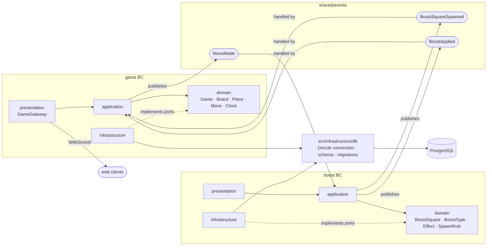

# Architecture

## Pattern

Feature-first by bounded context: one Nest module per BC in `apps/server/src/<bc>/`.
Inside each BC — light Clean Architecture with four layers:

| Layer            | Contains                                                         |
| ---------------- | ---------------------------------------------------------------- |
| `domain`         | entities, value objects, rules, ports (abstract classes) — pure TS |
| `application`    | use cases; publishes / handles integration events                |
| `infrastructure` | Drizzle repositories and other port implementations              |
| `presentation`   | HTTP controllers, WebSocket gateway, DTOs                        |

`<bc>.module.ts` is the composition root: it binds ports to implementations
(`{ provide: BoostRepository, useClass: DrizzleBoostRepository }`).

Bounded contexts:

- **game** — chess rules: `Game`, `Board`, `Piece`, `Move`, `Clock`.
- **boost** — `BoostSquare`, `BoostType`, `Effect`, `SpawnRule`.

## Dependency rule

```
presentation → application → domain ← infrastructure
                    ↓
              shared/events
```

- `domain` imports nothing outside itself — no `@nestjs/*`, no npm, no `shared/`.
- `application` → `domain`, `shared/events`.
- `infrastructure` implements ports from `domain`.
- `presentation` → `application` (+ `domain` types).
- BC ↔ BC only via `shared/events`. Enforced by `apps/server/.dependency-cruiser.cjs`
  (`make arch`).

## Contexts and events



`game` publishes `MoveMade` after every legal move; `boost` counts half-moves (each
side's move separately) and after every 7th one spawns a boost on a free square and
publishes `BoostSquareSpawned`; `game` relays it to both clients through `GameGateway`.
When a piece lands on a boost square, `boost` publishes `BoostApplied`; `game` applies
the effect to the board and re-validates the position.

## Layout

- `apps/server/src/<bc>/` — bounded contexts (`game`, `boost`), four layers each.
- `apps/server/src/shared/events/` — integration event contracts.
- `apps/server/src/infrastructure/db/` — shared Drizzle connection, `schema/`, `migrations/`.
- `apps/server/test/` — server tests.
- `apps/web/` — Nuxt 4 + Nuxt UI client; talks to the server only over WebSocket.
