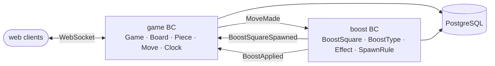

# chessboost

Online chess with boosts — a random power-up spawns on a free square every 7 half-moves.


[](LICENSE)

> 🚧 **Status:** architecture scaffold, no gameplay yet. The folders, empty Nest
> modules, architecture rules and docs are in place; the apps have no dependencies
> and no game logic so far.

## ♟️ The idea

Two players play standard chess online in real time, with a clock. After every 7th
half-move (each side's move counts separately) a boost spawns on a random free
square. Its type is picked at random from a fixed set, and the piece that lands on
the square gets the effect immediately:

- **Invulnerability** — the piece can't be captured for 1 move.
- **Extra move** — the player gets an extra move.
- **Teleport** — the piece teleports.

How extra move and teleport interact with check and mate is still an open question —
see [SPEC.md](SPEC.md#open-questions).

## 🧱 Tech stack

- **Monorepo:** pnpm workspaces (`apps/*`), Node 24
- **Server:** NestJS, TypeScript, WebSocket via `@nestjs/websockets`
- **Client:** Nuxt 4 + Nuxt UI
- **Database:** PostgreSQL (Docker Compose) + Drizzle ORM / drizzle-kit
- **Quality:** Jest for server tests, dependency-cruiser for architecture checks

## 🏗️ Architecture

The server is organised feature-first: one NestJS module per bounded context, `game`
(chess rules) and `boost` (spawning and effects). Inside each context there is a
light Clean Architecture with four layers — `domain` (pure TypeScript),
`application`, `infrastructure`, `presentation` — and the dependency rule is
enforced by dependency-cruiser. Contexts never import each other; they talk only
through integration events in `shared/events`.



Details, layer rules and the full diagram: [ARCHITECTURE.md](ARCHITECTURE.md).
Decisions and rejected alternatives: [docs/adr/](docs/adr/).

## 🚀 Getting started

Requirements: Node 24, pnpm 10, Docker with Compose.

The commands below are wired in the `Makefile`, but the apps have no dependencies
yet, so they won't do useful work until the scaffold is filled in.

```bash
pnpm install
cp .env.example .env   # then fill in the values
make dev               # start PostgreSQL and run server + web in watch mode
make test              # run server tests (Jest)
make migrate           # apply Drizzle migrations
make arch              # check architecture rules (dependency-cruiser)
```

## 📁 Project structure

```
chessboost/
├── apps/
│   ├── server/                    # NestJS
│   │   ├── src/
│   │   │   ├── game/              # game BC: domain, application, infrastructure, presentation
│   │   │   ├── boost/             # boost BC: same four layers
│   │   │   ├── shared/events/     # integration events, the only link between BCs
│   │   │   └── infrastructure/db/ # Drizzle connection, schema, migrations
│   │   ├── test/
│   │   └── .dependency-cruiser.cjs
│   └── web/                       # Nuxt 4 + Nuxt UI
│       └── app/                   # pages, components, composables
├── docs/adr/                      # architecture decision records
├── .devcontainer/
├── ARCHITECTURE.md
├── SPEC.md
├── Makefile
└── docker-compose.yml
```

## 📚 Docs

- [SPEC.md](SPEC.md) — goals, non-goals, acceptance criteria, open questions.
- [ARCHITECTURE.md](ARCHITECTURE.md) — pattern, dependency rule, contexts and events.
- [docs/adr/](docs/adr/) — architecture decision records, starting with
  [ADR 0001](docs/adr/0001-initial-setup.md).

## 🗺️ Roadmap

- [ ] Chess engine spike
- [ ] `game` BC — chess rules: game, board, pieces, moves, clock
- [ ] `boost` BC — spawning, boost types, effects
- [ ] Web UI — Nuxt client
- [ ] Realtime play — two players over WebSocket

## 📄 License

[MIT](LICENSE) © 2026 Gleb Bufin
