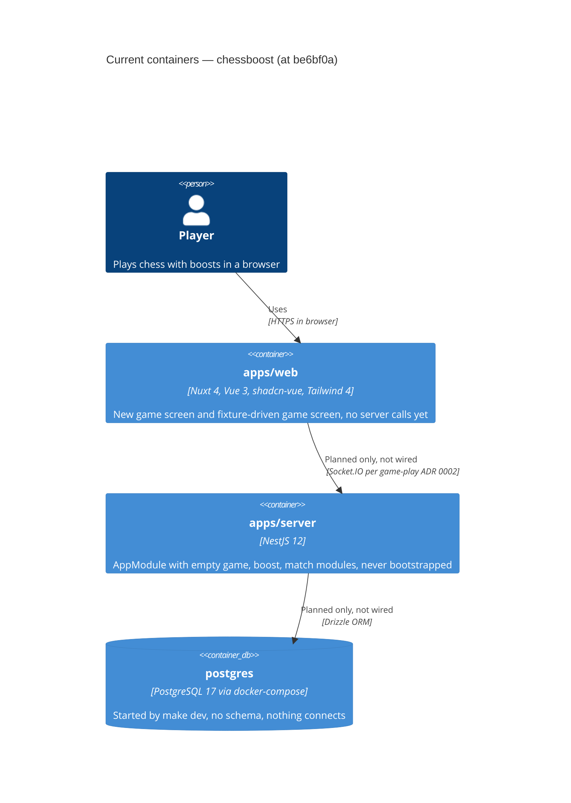

# Architecture map — chessboost

> The **current** architecture (what exists today), produced by `map-architecture` and read by
> write-prd / architecture-design / generate-data-model / implement-tasks. Refresh with
> `/sdlc:map-architecture` when the repo drifts past `reflects_commit`. The hand-maintained
> `ARCHITECTURE.md` + `CLAUDE.md` + ADRs stay authoritative for the **target**; this map records
> what the code actually contains and where it diverges (see the last section).

## Stack

- Language / runtime: TypeScript `^6.0.3` on Node `>=24` (`package.json` engines; no `.nvmrc`); pnpm `12.16.1` workspaces over `apps/*` (`pnpm-workspace.yaml:1-4`).
- Server: NestJS `@nestjs/common` / `@nestjs/core` `^12.2.0`, `reflect-metadata`, `rxjs` (`apps/server/package.json`). `tsconfig.json`: ES2023, `nodenext`, decorators on, strict.
- Web: Nuxt `^4.6.4`, Vue `^3.5.44`, shadcn-vue `^2.9.0` + `shadcn-nuxt` + reka-ui `^2.11.0`, Tailwind CSS `^4.3.4` via `@tailwindcss/vite`, `@lucide/vue`, `@vueuse/core`, `class-variance-authority`, `tw-animate-css` (`apps/web/package.json`).
- **Declared in docs/scripts but NOT in any manifest:** `drizzle-orm`, `drizzle-kit`, `pg`, `@nestjs/websockets`, `socket.io`, `chess.js`, `jest` / `ts-jest` / `@nestjs/testing`, `@nestjs/cli` (needed by `nest start`), any linter/formatter.
- Build / test / lint (always through `make`, `Makefile:1-20`): `make dev` (postgres + `pnpm -r --parallel dev`), `make test` (`pnpm -r test` → server `jest`), `make db-generate` / `make migrate` (drizzle-kit), `make arch` (depcruise), `make typecheck` (server `tsc --noEmit` only). Web has no `test` or `typecheck` script. **Today `make test`, `make db-generate`, `make migrate` and the server `dev` fail — their tools are not installed.**

## C4 — system as it is

## Module inventory

| Module | Path | Layers | Wired at | Responsibility |
|---|---|---|---|---|
| app root | `apps/server/src/app.module.ts` | — | `app.module.ts:6-8` | imports `GameModule`, `BoostModule`, `MatchModule`; `main.ts` is empty (1 byte) so nothing boots it |
| game | `apps/server/src/game/` | domain / application / infrastructure / presentation — all `.gitkeep` only | `app.module.ts:7`; `game.module.ts:1-4` empty `@Module({})` | chess rules, clock, rematch, presence (per README + game-play SAD) — no code |
| boost | `apps/server/src/boost/` | 4 layers, `.gitkeep` only | `app.module.ts:7`; `boost.module.ts:1-4` empty | boost squares, spawn rule, effects — no code |
| match | `apps/server/src/match/` | 4 layers, `.gitkeep` only | `app.module.ts:7`; `match.module.ts:1-4` empty | pairing — no code |
| auth / player / billing / notifications | `apps/server/src/<bc>/` | README only | not wired | planned (`docs/bc-map.md`) |
| shared/events | `apps/server/src/shared/events/` | `.gitkeep` only | — | integration event contracts (`MoveMade`, `BoostSquareSpawned`, `BoostApplied`) — none exist |
| db | `apps/server/src/infrastructure/db/` | `schema/`, `migrations/` `.gitkeep` only | — | shared Drizzle connection — none exists, no `drizzle.config.*` |
| web app | `apps/web/app/` | pages / components / composables / lib / types / assets | `apps/web/nuxt.config.ts:1-20` | client UI (see §Frontend) |

## Conventions (cited — the rules a new feature must match)

- **Module wiring / registration:** one Nest module per BC, imported in `AppModule` — `apps/server/src/app.module.ts:7`. Port → adapter binding inside `<bc>.module.ts` is documented (`ARCHITECTURE.md:16`) but has no code instance yet; the first feature sets the precedent.
- **Layer rules (enforced):** `apps/server/.dependency-cruiser.cjs` — `domain-no-nestjs` :5, `domain-no-external` :12, `domain-no-unresolvable` :30, `domain-only-own-domain` :37, `application-no-outer-layers` :44, `application-only-shared-events` :51, `presentation-via-application` :58, `no-cross-bc` :65, `infrastructure-no-bc` :72, `shared-no-bc` :79, `no-circular` :86 (all `error`), `no-orphans` :92 (`warn`). Passes trivially today — the tree is empty.
- **Error handling:** UNKNOWN on server (no code). Web: a local status ref `'idle' | 'creating' | 'error'` — `apps/web/app/composables/useCreateGame.ts:4`.
- **IDs:** UUID v7 by decision — `docs/adr/0003-uuid-v7-for-entity-ids.md`; no generator in code.
- **Persistence / DB access:** Drizzle repositories implementing domain ports (decision: `ARCHITECTURE.md`, `CLAUDE.md`); nothing implemented.
- **Migrations:** drizzle-kit into `apps/server/src/infrastructure/db/migrations/` via `make db-generate` / `make migrate` (`Makefile:10-14`); dir empty, naming = drizzle-kit default (not yet observed).
- **Tests:** Jest, server tests in `apps/server/test/` (`CLAUDE.md`, `ARCHITECTURE.md`); dir holds `.gitkeep` only, no `jest.config`, jest not declared. Web: no test harness.
- **Inter-module communication:** BCs talk only via `shared/events` (enforced by `no-cross-bc`); in-process event bus published after commit (`docs/features/game-play/adr/0006-…`). Nothing implemented.
- **Server ↔ web:** Socket.IO (`docs/features/game-play/adr/0002-socket-io-for-realtime-channel.md`); `.env.example` names `NUXT_PUBLIC_WS_URL`, `SERVER_PORT` — no `runtimeConfig` in `nuxt.config.ts`, no gateway. Web today mocks the call: `useCreateGame.ts:26-42` (800 ms timer, `?mock=fail`, then `navigateTo('/game/demo')`).
- **UI / styling:** shadcn-vue components copied into `app/components/ui/` + Tailwind 4 with CSS-variable tokens — `apps/web/components.json`, `apps/web/app/assets/css/tailwind.css` (detail below).
- **Formatting / lint:** none configured. Web code follows shadcn style (single quotes, no semicolons, e.g. `nuxt.config.ts`); server uses semicolons (`app.module.ts`).

## Datastores

| Store | Engine | Accessed via | Notes |
|---|---|---|---|
| `postgres` | PostgreSQL 17 (`postgres:17-alpine`, `docker-compose.yml:1-19`) | nothing yet (planned: Drizzle, `DATABASE_URL` in `.env.example`) | volume `pgdata`, `pg_isready` healthcheck; started by `make dev` (`Makefile:4`) |

## Frontend / UI foundation

- **Component library / design system:** shadcn-vue, style `reka-nova`, base colour `neutral`, CSS variables on, icons lucide, alias `@/components/ui` — `apps/web/components.json`; why: `docs/adr/0002-shadcn-vue-for-web-ui.md`. Canon: `docs/design/design-system.md` (token model, role tables, rules).
- **Design tokens:** two layers in `apps/web/app/assets/css/tailwind.css` — raw oklch palette in `:root` at :85 (`graphite-*`, `bone-100`, `wood-*`, `cyan-*`, `lemon-300`, `red-*`, `blue/green/magenta-*`); role tokens light `:root` at :123 and dark `.dark` at :181 (`background`, `foreground`, `card`, `primary`, `muted`, `accent`, `destructive`, `border`, `ring`, `board-light/dark/frame`, `highlight`, `boost-invuln/extra/teleport` (+ `-deep`, `-glow`, `-ui`, `-halo`), `counter-filled/empty`, `clock`, `clock-active`, `clock-low`, …); `@theme inline` mapping at :11 (colours, radii, `--animate-boost-appear`, `--animate-boost-fade-in`). Base radius `--radius: 0.5rem`. Font Archivo (:2). Custom variants `dark` (:8) and `wide` (:9, `width >= 64rem and aspect-ratio >= 27/20`). Components use role tokens only, never palette values (design-system.md rule).
- **Styling approach:** Tailwind 4 utilities (no `tailwind.config`; `@import "tailwindcss"`) + scoped CSS for layout grids. Dark by default — `nuxt.config.ts:13` puts `class="dark"` on `<html>`.
- **Shared primitives:** `app/components/ui/` — `button` (cva variants, `button/index.ts`), `card`, `radio-group`, `alert-dialog`, `tooltip`. Helper `cn` — `app/lib/utils.ts:1`. Domain components: `components/game/` (`GameScreen`, `GameBoard`, `PlayerClock`, `MoveList`, `BoostCounter`, `BoostStatus`, `GameActions`), `components/new-game/OptionTile.vue`. Piece art: `public/pieces/*.svg`.
- **State / data-fetching:** none beyond composables with local refs (`composables/useCreateGame.ts`); view types in `app/types/game.ts` (`GameView`, `Position`, `BoostType`, …); display helpers in `app/lib/game-format.ts`. No store, no socket client.
- **Closest UI precedent:** `components/game/GameScreen.vue` (props `game: GameView`, emits `offerDraw` / `resign` at :12-18; composes 7 child components under `TooltipProvider`; scoped CSS grid with the `wide` breakpoint at :73-117), fed by the fixture in `pages/game/demo.vue:7-77`. Form-style screen precedent: `pages/index.vue` (Card + RadioGroup + OptionTile).

## Where things live / closest precedents

- A new server capability → its BC folder `apps/server/src/<bc>/{domain,application,infrastructure,presentation}`, bound in `<bc>.module.ts`. No in-code precedent yet; follow `ARCHITECTURE.md` + `.claude/rules/server-architecture.md` + `.claude/rules/<bc>.md`, and `docs/features/game-play/sad.md` for the first real flows.
- A new cross-BC interaction → a contract in `apps/server/src/shared/events/` (none yet; the three named in `ARCHITECTURE.md` are first).
- A new table → `apps/server/src/infrastructure/db/schema/` + generated migration (tooling to be installed first).
- A new screen → `apps/web/app/pages/`, composed from `components/ui/*` + role tokens, modelled on `pages/game/demo.vue` → `GameScreen.vue`; a form screen on `pages/index.vue`.
- A new shadcn primitive → add it into `components/ui/` via shadcn-vue (ADR 0002), don't hand-roll.

## Constraints & known tech-debt

- **Backend is a skeleton.** No bootstrap (`main.ts` empty), no providers, no event contracts, no DB access. The first backend feature (game-play) must also land the bootstrap, Socket.IO gateway, Drizzle connection/config, Jest config and the missing deps.
- **Toolchain gaps:** `make test`, `make db-generate`, `make migrate`, server `dev` reference tools that aren't declared (jest, drizzle-kit, `@nestjs/cli`) — implement-tasks must add them before its gates can run.
- **No web tests / typecheck target** — `vue-tsc` is installed but no script or make target uses it.
- **Web is client-only mock** — `useCreateGame.ts` fakes creation; `pages/game/demo.vue` is a hard-coded `GameView`. `GameView` in `app/types/game.ts` is the de-facto client contract the server payloads should match or replace.
- **Single process** — game-play SAD/ADRs assume one server process (per-game queue, in-process bus, timers rearmed on boot: game-play ADR 0003/0004/0006).
- **Identity** via Cloudflare Access until an `auth` feature exists (game-play ADR 0008).
- `docs/design/design-system.md` refers to a Figma file and a raw-colour guard hook outside this repo — not verifiable here.

## Reconciliation with the authored architecture doc

Authored sources: `ARCHITECTURE.md`, `CLAUDE.md`, `docs/bc-map.md`, `docs/adr/0001–0003`, `docs/features/game-play/{sad.md,adr/0001–0008}`. **Aligned:** BC folder layout, four layers, depcruise rules, shadcn-vue/Tailwind web, PostgreSQL in compose. **Drift (code vs docs):**

1. Docs say Drizzle + `@nestjs/websockets` gateway + Jest; none are declared or present in code.
2. **Docs disagree with each other:** `ARCHITECTURE.md` / `CLAUDE.md` say "WebSocket via `@nestjs/websockets`", game-play ADR 0002 picks **Socket.IO**. (Nest's gateway can run on the Socket.IO adapter, so these may be compatible — worth one line in `CLAUDE.md` to state it.)
3. game-play ADR 0005 (chess.js behind a `ChessRules` port) — no chess.js, no port yet.
4. `ARCHITECTURE.md` says the web talks to the server only over WebSocket — today it talks to nothing (timer mock); `NUXT_PUBLIC_WS_URL` is unused.
5. `CLAUDE.md` "Nothing is installed yet" is stale — `node_modules` exist and the web app runs with shadcn components and design tokens.
