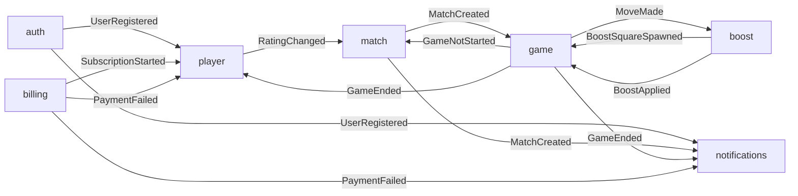

# Bounded Context Map

Event Storming lite for chessboost: 13 key domain events → 7 bounded contexts →
a shared vocabulary per context → who listens to whom.

## Events

1. **UserRegistered** — a player created an account
2. **MatchCreated** — two players were paired into one game
3. **GameStarted** — the game began, the clock is running
4. **MoveMade** — a player made a legal move
5. **GameEnded** — the game finished (EndReason: Mate / Resign / Timeout / Draw)
6. **BoostSquareSpawned** — after every 13th half-move a boost appeared on a free square
   (random type from a fixed set)
7. **BoostSquareExpired** — nobody stepped on the square in time, it disappeared
8. **BoostApplied** — a piece landed on the square, the effect applied immediately
9. **BoostExpired** — a lasting effect (e.g. invulnerability) ended
10. **RatingChanged** — a player's rating was updated after a game
11. **SubscriptionStarted** — a player subscribed
12. **PaymentFailed** — a subscription payment failed
13. **GameNotStarted** — a pairing could not become a game (e.g. a player already has an
    active game); carries `matchId` + reason
    ([game-play ADR-0006](features/game-play/adr/0006-in-process-event-bus-published-after-commit.md))

## Contexts and vocabulary

| BC | Owns events | Vocabulary | Status |
|---|---|---|---|
| **auth** | UserRegistered | User, Session, RefreshToken, VerificationToken | planned |
| **player** | RatingChanged | Player, Profile, Rating, GameRecord | planned |
| **match** | MatchCreated | MatchRequest, Queue, Opponent, TimeControl | scaffolded |
| **game** | GameStarted, MoveMade, GameEnded, GameNotStarted | Game, Board, Piece, Square, Move, Clock, EndReason, DrawOffer, RematchOffer, Presence | scaffolded |
| **boost** | BoostSquareSpawned, BoostSquareExpired, BoostApplied, BoostExpired | BoostSquare, BoostType, Effect, SpawnRule, Duration | scaffolded |
| **billing** | SubscriptionStarted, PaymentFailed | Subscription, Plan, Payment, Invoice | planned |
| **notifications** | — (listens only) | Notification, Channel, Template, Recipient | planned |

Polysemy is the boundary signal: a `Square` in **game** is a board coordinate (`e4`),
a `BoostSquare` in **boost** is an object with a lifecycle that only *refers* to a square;
a "user" is a `User` in **auth**, a `Player` in **player**, an `Opponent` in **match**
and a `Recipient` in **notifications**.

**game** owns the rematch (offer, acceptance, creating the new game with swapped colours)
and a player's presence in their game (online / offline) — not **match**; match pairs
players, a rematch reuses an existing pair
([game-play ADR-0007](features/game-play/adr/0007-game-context-owns-rematch-and-presence.md)).

## BC Map

**game ↔ boost** is a deliberate two-way link (the tightest on the map): boost listens to
moves to spawn squares, game listens to boost events to show squares and apply effects.
If it starts to hurt, boost effects could move into game's rules — revisit then.

## Structure level

**Feature-first** (one folder per BC, light Clean layers inside — see
[ADR 0001](adr/0001-initial-setup.md)). About 10 entities (upper end of the 3–10 range)
and one developer, so Hexagonal per BC would be premature; flat would mix 7 contexts.
**game** and **boost** are scaffolded first — they are the product core; the other
contexts have a folder with a README only until their turn comes.
