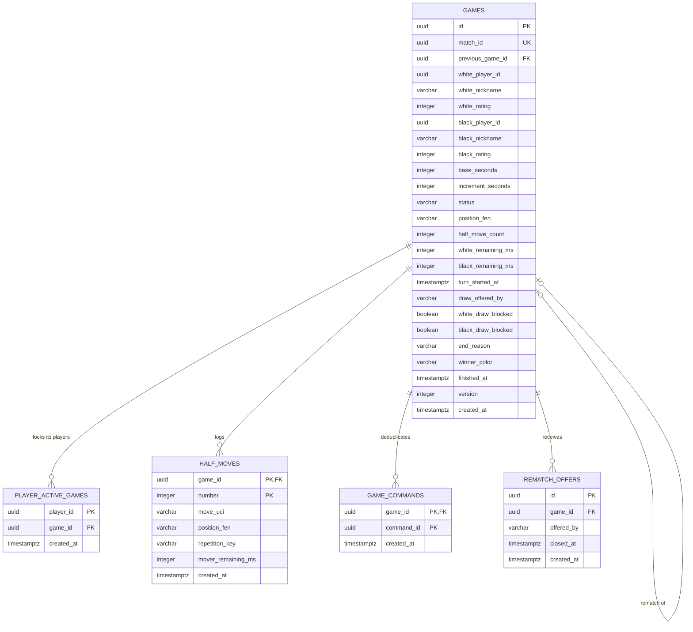

# Data model — game-play

<!-- Generated by generate-data-model. Migrations are STAGED under
docs/features/game-play/migrations/ (NOT the live migrations/ tree); implement-tasks promotes them. -->

> **Inputs:** [PRD](./PRD.md) §4–§6.1 · [sad.md](./sad.md) §5, §6 (sad.md has no §6.4 ER stub — relationships come from ADR-0003 (c), ADR-0006, ADR-0007 and the `persists …` notes in §6) · ADR [0003](./adr/0003-persist-each-action-before-broadcast-with-per-game-queue.md), [0004](./adr/0004-deadline-clock-with-per-game-timer-rearmed-on-boot.md), [0006](./adr/0006-in-process-event-bus-published-after-commit.md), [0007](./adr/0007-game-context-owns-rematch-and-presence.md) · repo [ADR 0003 UUID v7](../../adr/0003-uuid-v7-for-entity-ids.md).
>
> **Not persisted (by decision):** presence (in memory — ADR-0007); integration events / outbox (at-most-once, no outbox — ADR-0006); players and their accounts (player / auth contexts — game keeps only a snapshot of `playerId`, nickname and rating from `MatchCreated`, so there is no FK to a players table across contexts).

## ER diagram

## Entities

One aggregate: **`games`** is the root; `player_active_games`, `half_moves`, `game_commands` and `rematch_offers` are written only inside a transaction on their game, through that game's queue (ADR-0003). Enumerated values (`status`, `end_reason`, colours) are plain `VARCHAR` checked in code — no `CHECK`, no DB enum.

### `games`

| Column | Type | Constraints | Notes |
|---|---|---|---|
| `id` | UUID | PK, app-generated (UUID v7) | the id in the game link (AC-04) |
| `match_id` | UUID | NULL, UNIQUE | the pairing it was created from; idempotency key for a duplicate `MatchCreated`. NULL for a rematch |
| `previous_game_id` | UUID | NULL, UNIQUE, FK → `games(id)` | the ended game this rematch came from (ADR-0007, `GameStarted` link); UNIQUE = at most one rematch per ended game (AC-23). NULL for a pairing |
| `white_player_id` / `black_player_id` | UUID | NOT NULL | `playerId` snapshot from `MatchCreated`; no FK — the player context owns players. Authorization «is this person one of the two players» reads these (AC-04) |
| `white_nickname` / `black_nickname` | VARCHAR(32) | NOT NULL | snapshot shown to the opponent (AC-06, AC-30). <!-- TBD: nickname bound — the PRD sets none; 32 is provisional until the player / auth feature fixes the nickname rule --> |
| `white_rating` / `black_rating` | INTEGER | NULL | snapshot; NULL = no rating (AC-30) |
| `base_seconds` | INTEGER | NOT NULL | time control base (180 / 300 / 600) |
| `increment_seconds` | INTEGER | NOT NULL | time control increment (2 / 0) — added after every half-move of a side, incl. its first (AC-07) |
| `status` | VARCHAR(16) | NOT NULL | `active` · `ended` · `aborted` (app enum) |
| `position_fen` | VARCHAR(100) | NOT NULL | current position; the longest legal FEN is < 100 chars |
| `half_move_count` | INTEGER | NOT NULL | 0 → White's abort window, 1 → Black's abort window, ≥ 2 → main clocks run (AC-32, AC-33); also the next `half_moves.number` and the `MoveMade` number |
| `white_remaining_ms` / `black_remaining_ms` | INTEGER | NOT NULL | remaining time at `turn_started_at` (ADR-0004). After a game end they are left as at the last turn start, so the deadline stays derivable for the timeout-lateness check (sad.md §10 QG-3) |
| `turn_started_at` | TIMESTAMPTZ | NOT NULL | when the current turn (or abort window) began; wall-clock so downtime counts (AC-29b). Deadline = this + remaining of the side to move, or + abort window (20 s Blitz / 60 s Rapid) while `half_move_count < 2` — derived in code, never stored |
| `draw_offered_by` | VARCHAR(5) | NULL | `white` / `black` — the one waiting draw offer (AC-14b); a column, so «at most one waiting per game» holds by shape |
| `white_draw_blocked` / `black_draw_blocked` | BOOLEAN | NOT NULL | that side's offer was declined and it has not moved since (AC-15); reset by its next half-move. App always sets them — no DB default |
| `end_reason` | VARCHAR(32) | NULL | set only when `status = ended`: `mate` · `resign` · `timeout` · `draw_agreement` · `stalemate` · `insufficient_material` · `threefold_repetition` · `fifty_move_rule` · `timeout_vs_insufficient_material` (AC-09, AC-18). NULL for active and aborted (AC-32, AC-34) |
| `winner_color` | VARCHAR(5) | NULL | `white` / `black`; NULL for a draw, an active or an aborted game |
| `finished_at` | TIMESTAMPTZ | NULL | when the game ended or was aborted; source for the timeout-lateness measurement (PRD §6) |
| `version` | INTEGER | NOT NULL | optimistic-lock backstop, `+1` per accepted action (ADR-0003) |
| `created_at` | TIMESTAMPTZ | NOT NULL DEFAULT now() | also White's abort-window start (`turn_started_at` is set to the same moment by the app) |

**Aggregate root:** root.
**No `updated_at`** — the row is mutable (every action changes it), but the PRD asks for no «last changed» time; concurrency is covered by `version`, the end moment by `finished_at`, the history by `half_moves`. Deliberate, surfaced here.
**Access patterns:** open / act on a game by id → PK · duplicate `MatchCreated` → `uq_games_match_id` · rematch already created for this ended game → `uq_games_previous_game_id` · boot re-arm + 5 s safety sweep over active games → `idx_games_active_turn_started_at`.
**Constraints:** UNIQUE `match_id`; UNIQUE `previous_game_id`; self-FK `previous_game_id → games(id)`.

### `player_active_games`

| Column | Type | Constraints | Notes |
|---|---|---|---|
| `player_id` | UUID | PK | the player's id from the snapshot (not generated here) |
| `game_id` | UUID | NOT NULL, FK → `games(id)` | their one active game |
| `created_at` | TIMESTAMPTZ | NOT NULL DEFAULT now() | |

**Aggregate root:** `games`.
**Why a table:** «one active game per player» (ADR-0007 (a), AC-22b) must hold whatever the colour; a partial unique index on `games` can only cover one colour column. Two rows are inserted in the same transaction that creates a game (pairing or rematch) — a PK violation is AC-22b's «already have an active game» / `GameNotStarted`; both rows are **hard-deleted** in the transaction that ends or aborts the game.
**Access patterns:** create-game uniqueness → PK · release on game end / abort (`DELETE … WHERE game_id = ?`) → `idx_player_active_games_game_id`.

### `half_moves`

| Column | Type | Constraints | Notes |
|---|---|---|---|
| `game_id` | UUID | PK (1/2), FK → `games(id)` | |
| `number` | INTEGER | PK (2/2) | 1-based half-move number, = `games.half_move_count` after it; the `MoveMade` number |
| `move_uci` | VARCHAR(5) | NOT NULL | UCI incl. promotion piece (`e7e8q`, AC-03) |
| `position_fen` | VARCHAR(100) | NOT NULL | position after the half-move (ADR-0003 (c)); history for boosts / replays |
| `repetition_key` | VARCHAR(100) | NOT NULL | placement + side to move + castling + en passant only when legal (ADR-0003 (b), AC-18) — read back for threefold repetition |
| `mover_remaining_ms` | INTEGER | NOT NULL | mover's remaining time after the increment — PRD §6.1 «records … remaining times» |
| `created_at` | TIMESTAMPTZ | NOT NULL DEFAULT now() | accept time |

**Aggregate root:** `games`. Append-only, never updated or deleted.
**PK:** composite natural key `(game_id, number)` — deliberate deviation from the UUID v7 default: the log is never referenced by its own id, and the PK both enforces «one half-move per number» and serves as the FK index.
**Access patterns:** repetition / 50-move history of one game (`WHERE game_id = ? ORDER BY number`) → PK.

### `game_commands`

| Column | Type | Constraints | Notes |
|---|---|---|---|
| `game_id` | UUID | PK (1/2), FK → `games(id)` | the game whose queue processed the command (for a rematch accept — the ended game) |
| `command_id` | UUID | PK (2/2) | client-generated `commandId`; scoped per game so a reused id in another game cannot collide |
| `created_at` | TIMESTAMPTZ | NOT NULL DEFAULT now() | |

**Aggregate root:** `games`. Append-only.
**What is recorded:** only **accepted** commands, in the same transaction as their effect. A repeat of an accepted command returns `ok` with the current snapshot (AC-27b, AC-29); a rejected command changed nothing, so its repeat is simply evaluated again — clients never resend (ADR-0002).
**PK:** composite natural key — same deviation and reason as `half_moves`.
**Access patterns:** «was this commandId already processed in this game» → PK.

### `rematch_offers`

| Column | Type | Constraints | Notes |
|---|---|---|---|
| `id` | UUID | PK, app-generated (UUID v7) | |
| `game_id` | UUID | NOT NULL, FK → `games(id)` | the ended game the offer is attached to |
| `offered_by` | VARCHAR(5) | NOT NULL | `white` / `black` |
| `closed_at` | TIMESTAMPTZ | NULL | NULL = waiting. Set on accept, decline, cancel, New game, or another game starting for either player (AC-25, AC-25b, AC-26) — no close reason, every path shows the same outcome (sad.md §6). Going offline never sets it (AC-24) |
| `created_at` | TIMESTAMPTZ | NOT NULL DEFAULT now() | |

**Aggregate root:** `games` (the ended game).
**Access patterns:** the waiting offer of an ended game (snapshot, accept / decline) → `uq_rematch_offers_open_game_id` · cancel open offers of both players inside a game-creation transaction → the same partial index joined to `games` by PK.
**Constraints:** at most one waiting offer per ended game — partial UNIQUE on `game_id WHERE closed_at IS NULL` (AC-23 backstop).

## Indexes

| Index | Columns | Query it serves |
|---|---|---|
| `games_pkey` | `games(id)` | every action and snapshot read by game id — §6 `Open a game`, all flows |
| `uq_games_match_id` | `games(match_id)` UNIQUE | §6 `Create a game from a pairing` — `alt unique violation on match_id` (duplicate `MatchCreated`) |
| `uq_games_previous_game_id` | `games(previous_game_id)` UNIQUE | §6 `Rematch accepted` — at most one new game per ended game (AC-23); also the self-FK index |
| `idx_games_active_turn_started_at` | `games(turn_started_at) WHERE status = 'active'` | §6 `Critical flow 2` — on boot load all active games; 5 s safety sweep for active games past their deadline (ADR-0004 (b)); keeps both O(active games) as ended games accumulate |
| `player_active_games_pkey` | `player_active_games(player_id)` | §6 `Create a game from a pairing` `alt unique violation on active game per player`; `Rematch accepted` `else a player already has an active game` (AC-22b) |
| `idx_player_active_games_game_id` | `player_active_games(game_id)` | release both players on game end / abort (`DELETE … WHERE game_id = ?`) — §6 `A half-move ends the game`, `Abort a game nobody started`; also the FK index |
| `half_moves_pkey` | `half_moves(game_id, number)` | §6 `A half-move ends the game` — repetition key read back for threefold repetition; FK index |
| `game_commands_pkey` | `game_commands(game_id, command_id)` | §6 `Half-move against the clock` — «check idempotency key commandId within this game»; FK index |
| `uq_rematch_offers_open_game_id` | `rematch_offers(game_id) WHERE closed_at IS NULL` UNIQUE | §6 `Rematch offer kept or withdrawn` — read the waiting offer; `Rematch accepted` — close / cancel open offers; FK index for the only rows ever queried |

## Seeds

None — no bootstrap rows and no lookup tables (enumerations are app enums).

## Test fixtures

Not generated now: the server has no domain types, Jest config or `apps/server/test/` code yet, so factories would target types that do not exist. Planned for implement-tasks (Jest, `apps/server/test/fixtures/`), PII guard — nicknames like `Test White` / `Test Black`, no emails:

- `newGame(overrides)` — an active game, 3+2, `half_move_count = 0`, initial FEN, both clocks at base time.
- `newGameAfterFirstMoves(overrides)` — `half_move_count = 2`, main clocks running.
- `newEndedGame(reason, winner)` / `newAbortedGame()` — for result, rematch and AC-20 / AC-34 tests.
- `newRematchOffer(game, offeredBy)` — a waiting offer on an ended game.

## Promote-time notes (for implement-tasks)

- The repo generates migrations with **drizzle-kit** (`make db-generate` → `apps/server/src/infrastructure/db/migrations/`, drizzle naming + journal, no down files). These staged `.up.sql` / `.down.sql` pairs are the reviewed contract: write the Drizzle schema in `apps/server/src/infrastructure/db/schema/` to match them, generate with `make db-generate`, and diff the generated SQL against the staged `.up.sql`; the `.down.sql` stays as the manual rollback. See the audit report.
- Order matters: `games` → `player_active_games` → `half_moves` → `game_commands` → `rematch_offers` (FKs).
