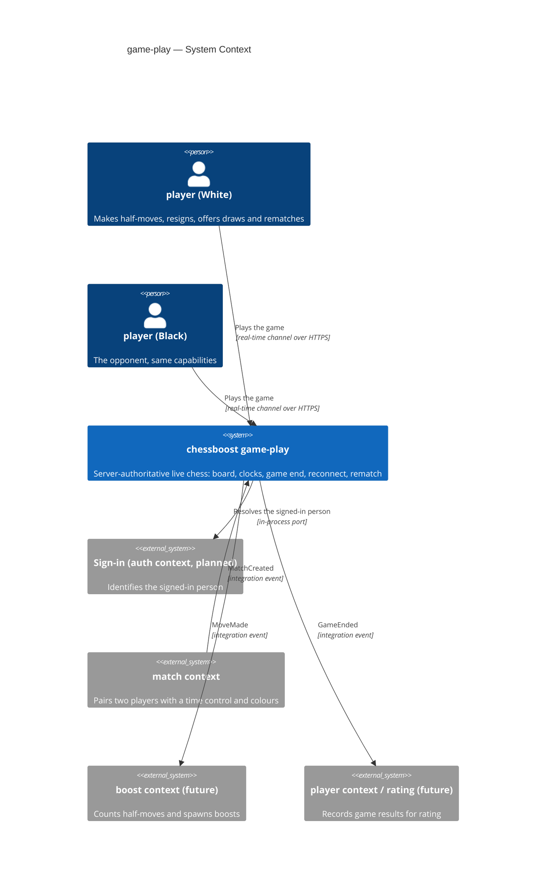
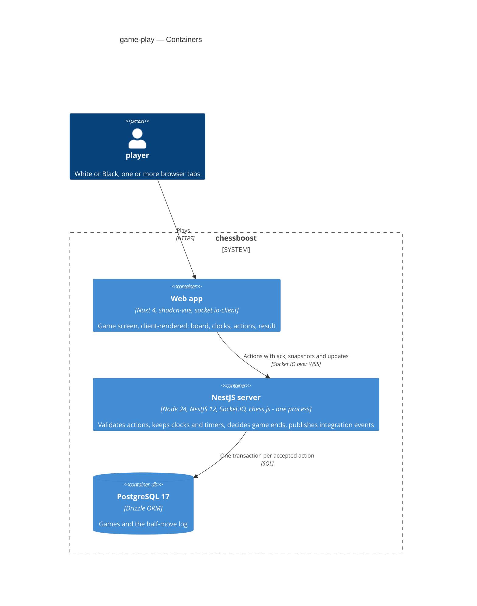
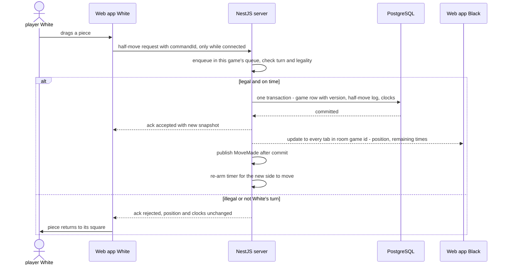
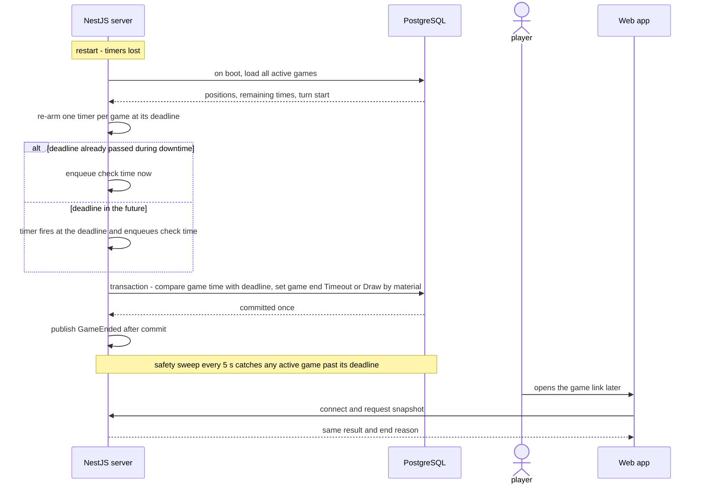
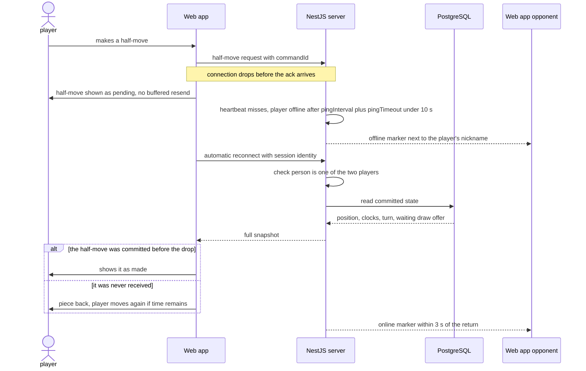

# Software Architecture Document — game-play

<!-- Stages 04-05 → see sdlc/plugin/skills/architecture-design/SKILL.md -->
<!-- 12 Arc42 sections. Empty sections — <!-- N/A: <one-line reason> -->. -->
<!-- C4 Context (L1) lives inline in §3. C4 Container (L2) lives inline in §5. -->
<!-- §6 Runtime view seeds the primary flow(s) here; complete-sequence-diagrams (stage 06) then -->
<!--    fills §6 with every critical flow / §5 AC — no cap. -->
<!-- Numbers in §10 come VERBATIM from PRD §6 NFR — no inventing, no rounding. -->

## 1. Introduction and goals

<!-- 🎯 Навіщо: стабільна памʼять про «що + три головні якості + хто зацікавлений».     -->
<!--           Через рік ніхто не згадає на словах, ЯКІ ТРИ ЯКОСТІ для системи критичні. -->
<!-- 📋 Що писати: 1 абзац intent + 3 рядки топ-3 якості + таблиця stakeholders.        -->
<!-- 📌 Приклад: «QG-1: швидкість редагування блоку p95 ≤500 мс»                         -->

**Intent.** game-play turns chessboost from a static demo into real two-player online chess: two paired players play legal chess under a running clock; every game reaches exactly one correct game end (Mate, Resign, Timeout, Draw) or is aborted; a disconnected player returns to the same game; and the pair can go straight into a rematch. It is the foundation the boosts feature runs on. First users: the author and 1–2 friends playing 10 scripted games (PRD §1).

**Top-3 quality goals (1-liners; full scenarios in §10):**

1. **Single authoritative outcome** — every game reaches exactly one game end or abort, identical on both screens, even when one or both players are offline (PRD §2 Goal 1; AC-08, AC-10, AC-16, AC-23).
2. **Real-time sync** — half-move delivery to the opponent ≤ 500 ms p95; clocks on both screens agree within ≤ 0.5 s (PRD §6).
3. **Recoverability** — a reconnect or a server restart resumes the real position and clocks (shown ≤ 3 s after reopening); a clock that runs out ends the game ≤ 1 s later, also when both players are offline (PRD §6; AC-27, AC-29b).

**Stakeholders.**

| Role | Interest | Sign-off owner? |
|---|---|---|
| player | plays games; needs the same result and reason on both screens | No |
| Gleb Bufin (author — Architect / Tech Lead) | builds the feature, approves the SAD | Yes |
| match context | produces the pairing a game is created from | No |
| boost context (future feature) | consumes every half-move with position + half-move number | No |
| player context / rating (future feature) | consumes each game end exactly once | No |

<!-- Decision overrides (¶4) — populated by the Step-7 critic resolution loop, empty otherwise.       -->
<!-- Each: «Decision override: <headline> — rationale: <reason>» so downstream skills see the choice.  -->

## 2. Constraints

<!-- 🎯 Навіщо: §4 (стратегія) працює тільки коли §2 зафіксувала, ЩО ВЖЕ ЗАФІКСОВАНО:    -->
<!--           стек, версії, дедлайн, регуляторні вимоги. Це вхід, не вихід.             -->
<!-- 📋 Що писати: чотири блоки — Технічні / Організаційні / Конвенції / Регуляторні.     -->
<!-- 📌 Приклад: «Postgres 18» (не «Postgres»); «дедлайн Q3 — жорсткий» (не «бажано»).    -->

**Technical.**
- Runtime Node 24; pnpm workspaces monorepo (`apps/*`), `pnpm@12.16.1`.
- Server: NestJS ^12.2, TypeScript ^6.0; real-time via `@nestjs/websockets` (stack fixed in `CLAUDE.md`; not installed yet).
- Web: Nuxt ^4.6, Vue ^3.5, shadcn-vue ^2.9 (`docs/adr/0002-shadcn-vue-for-web-ui.md`), Tailwind ^4.3; game-screen components already exist in `apps/web/app/components/game/` (static demo data only).
- Data: PostgreSQL 17 (`postgres:17-alpine`, `docker-compose.yml`) + Drizzle ORM / drizzle-kit (not installed yet). No Redis, no message broker.
- Architecture: feature-first bounded contexts + light Clean (`docs/adr/0001-initial-setup.md`); `presentation → application → domain ← infrastructure`; contexts talk only via `shared/events`; enforced by `apps/server/.dependency-cruiser.cjs` (`make arch`). `domain` imports no npm package, so any chess library sits behind a port.
- Tests: Jest (not installed yet; no config).

**Organisational.**
- One developer (the author) working with agents.
- No hard deadline in the PRD. Gate: ≥ 9/10 scripted games reach a correct game end before boosts reach circle 2 (PRD §7). The clock spike runs first; a scope cut is decided at the end of implementation week 1 (PRD §8).
- Prerequisite features are not built: registration / sign-in and «how players meet» (pairing). game-play consumes their outputs through ports.

**Conventions.**
- `CLAUDE.md`, `.claude/rules/server-architecture.md`, `.claude/rules/game.md`, `.claude/rules/web-design.md`.
- Only make targets (`make dev|test|arch|db-generate|migrate`); Conventional Commits.
- UI tokens and components from `docs/design/design-system.md`.

**Regulatory / external.**
- No regulated data — classification «internal» (PRD §6.1).
- Mandatory controls (PRD §6.1): per-game player authorization; time and game end decided only by the server; non-player and non-existent games look the same.
- Security review required — first authorization boundary and first real-time channel between players.

## 3. Context and scope

<!-- 🎯 Навіщо: малює КОРДОН СИСТЕМИ — хто з нею говорить ззовні, де закінчується зона довіри. -->
<!--           Без §3 §5 і §8 (авторизація) розпливаються — неясно, що «всередині», а що «зовні». -->
<!-- 📋 Що писати: 2-3 речення бізнес-контексту + таблиця зовнішніх систем + Mermaid C4Context. -->
<!-- 📌 Приклад: «зовнішні — нема (свідома відмова від third-party у v1)» — це теж рішення.   -->
<!-- Кордон довіри (trust boundary) — лінія, за якою ти не довіряєш даним без перевірки.       -->

game-play lets two paired players play one live game of chess in the browser: the server alone decides legality, time and the game end, and both screens mirror it. It starts where the match context's pairing ends and hands each half-move and each game end to the contexts that build on it (boost, player/rating). Trust boundary: everything a player's browser sends is a request to be validated — never a fact (PRD §6.1).

<!-- brownfield: server side is greenfield — game/boost/match contexts are empty scaffolds; web has static game-screen components (apps/web/app/components/game/) -->

**External systems (in / out):**

| Actor or system | Type | Interaction |
|---|---|---|
| player (White / Black) | Person | Makes half-moves, resigns, offers / answers draws and rematches, reconnects — over a real-time channel from the browser |
| Sign-in (auth context, planned feature) | System (internal, other context) | Tells game-play who the signed-in person is; game-play then checks they are one of the game's two players |
| match context | System (internal, other context) | Produces the pairing (two players, time control, colours) a game is created from — `MatchCreated` |
| boost context (future feature) | System (internal, other context) | Consumes `MoveMade` (position + half-move number) |
| player context / rating (future feature) | System (internal, other context) | Consumes `GameEnded` once per game end; aborted games are not published as a game end |

**C4 Context (L1):**



## 4. Solution strategy

<!-- 🎯 Навіщо: 3-4 СТРАТЕГІЧНІ СТОВПИ, з яких потім ростуть усі ADR. Без §4 кожен ADR    -->
<!--           виглядає випадковим — нема зонтика. ⭐ Найгустіша секція — тут ADR-gate    -->
<!--           спрацьовує майже завжди (рішення незворотні + мульти-модульні).            -->
<!-- 📋 Що писати: спершу Target surface(s), потім 3-4 стратегічні вибори.                -->
<!--           На кожен — заголовок + 2-3 речення rationale.                              -->
<!-- 📌 ПЕРШЕ рішення §4 — Target surface(s): ЩО САМЕ будуємо. Записується у frontmatter   -->
<!--           target_surfaces: [...] і гейтить §5 (один контейнер на поверхню) + усі       -->
<!--           наступні стадії. Деривиться з PRD §1 «для кого» + §4 ролей. → _shared/surfaces.md -->
<!-- 📌 Приклад: «Зберігати урок як таблицю блоків» — стовп, з якого виросло ADR-0001.    -->

**Target surface(s) (the first decision — what's being built):** `[backend-service, web-frontend]` — game-play ADR-0001 ([adr/0001-build-backend-service-and-web-frontend.md](adr/0001-build-backend-service-and-web-frontend.md)). The backend owns the real-time contract and the state; the existing Nuxt app consumes it.

**Given, not decided here — the server is authoritative** (PRD §6.1): a browser sends only intents («move e2→e4», «resign», «offer draw»); legality, time and the game end are decided by the server, and clients render the server's state. Every choice below follows from this.

**UI-architecture (web-frontend) — inline, no ADR** (gate 1/3: rework < 3 days, web module only). The game route `/game/**` is client-rendered inside the existing Nuxt app (`routeRules: { '/game/**': { ssr: false } }`); the rest of the site keeps its rendering. One composable `useGame(id)` owns the live game state, fed by the real-time channel; the existing `GameScreen` / `GameBoard` / `PlayerClock` / `GameActions` components and the design-system tokens are reused. Until the first server snapshot arrives the page shows a skeleton — an empty board without pieces and inactive clocks, never a guessed position. Rationale: the state only exists live, so server-side HTML would be stale on arrival and would need a second (HTTP) channel.

**Top strategic choices (the seeds for ADRs):**

1. **Socket.IO as the real-time channel** — game-play ADR-0002 ([adr/0002-socket-io-for-realtime-channel.md](adr/0002-socket-io-for-realtime-channel.md)). Rooms per game (every tab of both players), acks per action, a heartbeat tuned for the offline marker ≤ 10 s, and automatic reconnection serve QG-2 and QG-3. Actions are sent only while connected, each with an ack and a timeout; after a reconnect the client takes a full snapshot instead of relying on the client's emit buffer (AC-27b).
2. **Persist each action before broadcast, one queue per game** — game-play ADR-0003 ([adr/0003-persist-each-action-before-broadcast-with-per-game-queue.md](adr/0003-persist-each-action-before-broadcast-with-per-game-queue.md)). PostgreSQL is the source of truth: each accepted action is one transaction (game row with a version + an append-only half-move log), broadcast only after commit. Actions of one game — including timeout and abort checks — are processed strictly one at a time; the version column is a database-level backstop; a client `commandId` makes retries and second tabs idempotent. Serves QG-1 and QG-3.
3. **Deadline clock, one timer per game, re-armed on boot** — game-play ADR-0004 ([adr/0004-deadline-clock-with-per-game-timer-rearmed-on-boot.md](adr/0004-deadline-clock-with-per-game-timer-rearmed-on-boot.md)). The server stores remaining times and the moment the current turn began (before a side's first half-move: the abort deadline). A per-game timer fires at the deadline and enqueues a time check; on boot all active games are loaded and their timers re-armed; a safety sweep every 5 s catches any overdue active game. Clients receive remaining times and count down with a monotonic timer from receipt. Serves QG-1 and QG-3; validated first by the clock spike (PRD §8).
4. **chess.js behind a `ChessRules` port** — game-play ADR-0005 ([adr/0005-chess-js-behind-chess-rules-port.md](adr/0005-chess-js-behind-chess-rules-port.md)). Move legality comes from a pinned chess.js in `game/infrastructure`; the domain keeps game-end precedence, insufficient material per AC-18, «can this side mate by material» (AC-09), clocks and offers.
5. **In-process event bus, published after commit** — game-play ADR-0006 ([adr/0006-in-process-event-bus-published-after-commit.md](adr/0006-in-process-event-bus-published-after-commit.md)). game publishes `GameStarted`, `MoveMade`, `GameEnded` and the new `GameNotStarted { matchId, reason }` (pairing refused, AC-22b) through `shared/events` after the transaction commits, and consumes `MatchCreated`. Handlers are isolated: a consumer's failure never reaches the player's action.

Each tactical decision in later sections should be traceable to one of these strategic seeds. Tactical decisions that *contradict* a strategic choice are red flags — surface them in §11 Risks.

## 5. Building block view

<!-- 🎯 Навіщо: ВНУТРІШНЯ ДЕКОМПОЗИЦІЯ — модулі, контейнери, БД. Статична топологія:   -->
<!--           хто з ким може говорити. Без §5 §6 (сценарії) не має словника учасників. -->
<!-- 📋 Що писати: 1 абзац про стиль (шари/гексагональна/clean/на подіях) +            -->
<!--           дерево папок + Mermaid C4Container.                                       -->
<!-- 📌 ОДИН Container на кожну оголошену target_surface (frontmatter): fullstack        -->
<!--           [backend-service, web-frontend] = backend-API container + web/SPA container; -->
<!--           [backend-service, mobile-app] = API + mobile app. Container(web, …) нижче — -->
<!--           лише приклад однієї поверхні; додай/заміни під оголошене у §4. → _shared/surfaces.md -->
<!-- 📌 Приклад: «web-app, content-api, media-worker, postgres, s3, cdn».                -->

Light Clean Architecture inside one bounded context, following the repo convention (`docs/adr/0001-initial-setup.md`, `apps/server/.dependency-cruiser.cjs`): `presentation → application → domain ← infrastructure`, ports as abstract classes in `domain`, bindings in `game.module.ts`. The whole feature lives in the **game** context, including the rematch and in-game presence — game-play ADR-0007 ([adr/0007-game-context-owns-rematch-and-presence.md](adr/0007-game-context-owns-rematch-and-presence.md)). «One active game per player» is a database uniqueness rule shared by both game-creation paths.

**Internal decomposition (server, `apps/server/src/`):**

```
game/
├── domain/          Game aggregate (position, clocks, draw/rematch offers, status, game-end precedence),
│                    TimeControl, EndReason, repetition key; ports: ChessRules, GameRepository,
│                    TimeSource, GameScheduler
├── application/     use cases: CreateGameFromPairing, MakeHalfMove, Resign, OfferDraw, AnswerDraw,
│                    CancelGame, CheckTime, OfferRematch, AnswerRematch, GetSnapshot;
│                    GameCommandQueue (one queue per game), TimerService (re-arm on boot + 5 s sweep),
│                    PresenceRegistry, MatchCreated handler, EventPublisher port
├── infrastructure/  DrizzleGameRepository, ChessJsRules, SystemTimeSource, NodeTimerScheduler,
│                    EventPublisher adapter
├── presentation/    GameGateway (Socket.IO, rooms game:<id>, handshake identity), message DTOs
└── game.module.ts   binds ports to implementations
shared/events/       GameStarted, MoveMade, GameEnded, GameNotStarted, MatchCreated
infrastructure/db/   Drizzle connection, schema/, migrations/
```

**Internal decomposition (web, `apps/web/app/`):**

```
pages/game/[id].vue        client-rendered game route (routeRules ssr: false)
composables/useGame.ts     socket, snapshot, local countdown, commandId + ack
components/game/*          reused: GameScreen, GameBoard, PlayerClock, GameActions;
                           new only where nothing fits (result screen, abort countdown)
```

**C4 Container (L2):**



**Modules inside the NestJS server** (one process — not separate containers):

- **game context** (this feature) — the `GameGateway` (Socket.IO, rooms `game:<id>`), use cases, one queue per game, timers re-armed on boot, rematch and presence. Maps to the `backend-service` surface.
- **Event bus** (`shared/events`, in-process — game-play ADR-0006) — game publishes `GameStarted`, `MoveMade`, `GameEnded`, `GameNotStarted` after commit; game consumes `MatchCreated`.
- **match context** (built by its own feature) — publishes `MatchCreated`, from which game creates a game.
- **Sign-in / auth context** (planned) — identifies the signed-in person; game asks it through a port at the Socket.IO handshake and then checks the person is one of the game's two players.

The **Web app** maps to the `web-frontend` surface.

## 6. Runtime view

<!-- 🎯 Навіщо: ПОТІК У RUNTIME для 1-2 критичних сценаріїв. Хто з ким коли і у якому     -->
<!--           порядку говорить. Без §6 §5 — лише купа коробок без життя.                  -->
<!-- 📋 Що писати: Mermaid sequenceDiagram. Учасники — імена з §5 (не вигадуй нові!).      -->
<!--           Повідомлення семантичні («складає чорновик»), БЕЗ HTTP-методів/шляхів —     -->
<!--           ендпоінт-рівневі sequence-діаграми зʼявляться у stage 06 (api-forge).        -->
<!-- ⏳ RESERVED FOR SEQUENCES: architecture-design сіє лише primary flow(s) тут.          -->
<!--           complete-sequence-diagrams (stage 06) ДОПОВНЮЄ §6 кожним критичним flow /    -->
<!--           кожним §5 AC — без обмеження. Не намагайся покрити все тут.                  -->
<!-- 📌 Приклад: «methodist → web-app: складає чорновик → web-app → content-api: зберегти». -->

Participants are the §5 containers. Inside the NestJS server every action of one game passes through that game's queue (game-play ADR-0003). These are the seed flows; `complete-sequence-diagrams` covers every AC.

**Critical flow 1: a half-move, accepted or rejected (QG-1, QG-2; AC-01, AC-02, AC-29)**



**Critical flow 2: a clock runs out while both players are offline, across a server restart (QG-1, QG-3; AC-08, AC-28, AC-29b)**



**Critical flow 3: reconnect after a drop right after a half-move (QG-3; AC-27, AC-27b, AC-31)**



## 7. Deployment view

<!-- 🎯 Навіщо: ТОПОЛОГІЯ, яку DevOps має знати без читання Helm-чартів — скільки реплік,  -->
<!--           де живе фоновий обробник, ПРИ ЯКИХ ЧИСЛАХ масштабуємось.                     -->
<!-- 📋 Що писати: 2-3 речення про топологію + метрики + алерти + конкретні числа-пороги.   -->
<!-- 📌 Приклад: «500 IC → партиціонування за кварталом» (не «при зростанні подумаємо»).    -->
<!-- 🎯 Можна N/A для XS/S функцій, що переюзають існуюче розгортання без змін.            -->

One NestJS server process — exactly **one replica**, because the per-game queue (game-play ADR-0003), the timers (game-play ADR-0004) and the event bus (game-play ADR-0006) live in one process — next to the Nuxt app (its Node server serves pages; `/game/**` renders in the browser) and PostgreSQL 17. Locally everything runs with `make dev`. No sticky sessions are needed with one replica; the public entry must pass WebSocket upgrades.

**Circle 1 hosting (inline decision, no ADR — moving takes hours):** the author's home NAS (UGREEN DXP2800 GT, x86-64, 8 GB RAM, Docker via UGOS App Center).

- `docker compose` with three services: `postgres`, `server` (exactly 1 replica), `web`.
- Public access through **Cloudflare Tunnel** on a subdomain of `chessboost.games` (e.g. `play.chessboost.games`); no router ports are opened, the NAS admin UI is never exposed, and the containers get no access to the NAS file volumes.
- Backup: a daily `pg_dump` to a separate NAS volume.
- Deploy = a short restart; games continue per AC-29b (time while down counts against the side to move).

**Monitoring** (no on-call; logs are reviewed after the scripted games, as PRD §6 measurement requires):
- Half-move delivery: the server logs the accept time of every half-move, each client logs when it shows it → p95 ≤ 500 ms.
- Clock agreement: both clients log the remaining time they display for every half-move → difference ≤ 0.5 s.
- Timeout lateness: game-end time minus the deadline → ≤ 1 s.
- Every safety-sweep hit is logged as WARN (game-play ADR-0004) — it means a timer was lost.
- Clients log when the offline / online marker appears; the server logs Socket.IO connect / disconnect per game.

**Scaling thresholds:**
- ≥ 20 concurrent games is verified by the bot smoke test before circle 2 (PRD §6).
- Trigger to run more than one server process: the smoke test fails at 20 games, or zero-downtime deploys become necessary → revisit game-play ADR-0002 (shared Socket.IO adapter), ADR-0003 / ADR-0004 (distributed lock and scheduler) and ADR-0006 (broker).
- Data volume is negligible: circle 1 ≈ 10 games × ~80 half-moves.
- Hosting is revisited before circle 2 (§11).

## 8. Crosscutting concepts

<!-- 🎯 Навіщо: НАСКРІЗНІ ПАТЕРНИ, які перетинають кілька модулів: логування, помилки,    -->
<!--           авторизація, ID strategy, outbox, кеш. ⭐ Друга найгустіша секція.          -->
<!--           Якщо патерн всередині одного модуля — він НЕ сюди. Якщо це конвенція        -->
<!--           проєкту в цілому — у CLAUDE.md.                                              -->
<!-- 📋 Що писати: таблиця концепт / конвенція / де визначено. Один рядок на концепт.      -->
<!-- 📌 Приклад: «UUID v7 (час+випадковий, сортується) у app-layer» — як default з CLAUDE.md. -->

| Concept | Convention | Where defined |
|---|---|---|
| Authentication | `CurrentPerson` port read at the Socket.IO handshake. Circle 1: Cloudflare Access (email one-time code, 3-address allowlist); the adapter verifies the signed Access JWT (signature + audience) and maps email → player. The auth feature later replaces the adapter. Local dev: dev-only adapter. | game-play ADR-0008 ([adr/0008-cloudflare-access-identity-until-auth-feature.md](adr/0008-cloudflare-access-identity-until-auth-feature.md)) |
| Authorization | «Is this person one of the game's two players?» checked in `application` on every action and on joining the room `game:<id>`; someone else's game and a non-existent one get the same «not found or not available» reply (AC-04). | here |
| Error handling | Domain errors are typed results (`IllegalMove`, `NotYourTurn`, `GameOver`, `DrawOfferNotAllowed`, …); `presentation` maps them to an ack `{ ok: false, code: 'game.<reason>' }`; no exception ever reaches the socket. | here |
| ID strategy | UUID v7 generated in `application` for entities; clients generate `commandId` UUIDs. | `docs/adr/0003-uuid-v7-for-entity-ids.md` |
| Time | One `TimeSource` port. Deadlines and moments are persisted as wall-clock time (so downtime counts, AC-29b); in-process timers measure with monotonic time. | game-play ADR-0004 |
| Validation | Schema-validated DTOs at the gateway, unknown fields rejected; client messages never carry time or results (PRD §6.1). | here |
| Idempotency | Every action carries a client `commandId`; a repeat returns the original outcome. | game-play ADR-0003 |
| Abuse limits | Domain rules only in v1 (one draw offer per own half-move — AC-15; repeated Rematch presses count once — AC-23); no rate limit while the Cloudflare Access allowlist is the gate (trigger in §11). | here |
| Logging | Structured JSON logs with `gameId`, `halfMove`, `commandId` and the measurement events listed in §7. | §7 |
| Observability | Log-based measurement of the PRD §6 NFRs; no metrics stack in v1. | §7 |
| Internationalisation | No i18n framework; UI copy comes from `docs/design/`. | — |
| Events | Contracts in `shared/events`, published after commit, isolated handlers. | game-play ADR-0006 |

## 9. Architecture decisions

<!-- 🎯 Навіщо: ЗВОРОТНИЙ ІНДЕКС на папку adr/. `ls adr/` дає файли, §9 дає семантику —    -->
<!--           чому вони існують, до якого зрізу SAD привʼязані, у якому статусі.           -->
<!-- 📋 Що писати: таблиця з 4 колонками. Один рядок на ADR. Mixed status — це OK.         -->
<!-- 📌 Приклад: «0001 | Зберігати урок як таблицю блоків | Accepted | §4».                -->

| # | Title | Status | Section |
|---|---|---|---|
| [0001](adr/0001-build-backend-service-and-web-frontend.md) | Build game-play as a backend service plus the existing web frontend | Accepted | §4 |
| [0002](adr/0002-socket-io-for-realtime-channel.md) | Use Socket.IO as the real-time channel between server and players | Accepted | §4 |
| [0003](adr/0003-persist-each-action-before-broadcast-with-per-game-queue.md) | Persist each action before broadcast and process one game's actions through a single queue | Accepted | §4 |
| [0004](adr/0004-deadline-clock-with-per-game-timer-rearmed-on-boot.md) | Keep a deadline clock with one timer per game, re-armed on boot | Accepted | §4 |
| [0005](adr/0005-chess-js-behind-chess-rules-port.md) | Use chess.js behind a ChessRules port for move legality | Accepted | §4 |
| [0006](adr/0006-in-process-event-bus-published-after-commit.md) | Publish integration events on an in-process bus after the transaction commits | Accepted | §4 |
| [0007](adr/0007-game-context-owns-rematch-and-presence.md) | Let the game context own the rematch and a player's presence in their game | Accepted | §5 |
| [0008](adr/0008-cloudflare-access-identity-until-auth-feature.md) | Identify players through Cloudflare Access until the auth feature exists | Accepted | §8 |

ADR files live under `docs/features/game-play/adr/NNNN-<title>.md`. Repo-level ADRs this SAD relies on: `docs/adr/0001-initial-setup.md` (bounded contexts + light Clean), `docs/adr/0002-shadcn-vue-for-web-ui.md` (web UI kit), `docs/adr/0003-uuid-v7-for-entity-ids.md` (ID strategy, decided during this walk). Below the ADR gate and recorded inline: client-rendered `/game/**` (§4), circle-1 hosting on the home NAS (§7).

## 10. Quality requirements

<!-- 🎯 Навіщо: ДЕРЕВО ЯКОСТЕЙ (Quality Tree) — беремо мету з §1 і розкладаємо на          -->
<!--           конкретні листя: тести, метрики, конфіги, drill-и. ⭐ Без §10 §1 — це       -->
<!--           маніфест. З §10 кожна декларація мапиться на щось, ЩО МОЖНА ДОВЕСТИ.        -->
<!-- 📋 Що писати: на кожну якість з §1 — When / Then / How verify. Числа з PRD §6 NFR     -->
<!--           ДОСЛІВНО (не округлюй p95 ≤250мс до ≤300мс — це F6-помилка критика).        -->
<!-- 📌 Приклад: «p95 ≤500 мс на UPDATE блоку, перевіримо k6 load test 100 req/s».        -->

Each top-3 goal from §1 expanded into a full scenario:

**QG-1. Single authoritative outcome**
- **When:** actions compete — a half-move and a clock reaching zero at nearly the same moment (AC-10), two draw offers at once (AC-16), Rematch pressed twice or by both players (AC-23), the same half-move from two tabs (AC-29), a server restart mid-game (AC-29b).
- **Then:** exactly one game end or abort; the same result and end reason on both screens — «0 mismatches across all scripted games» (PRD §7).
- **How verify:** `application` unit tests with a fake `TimeSource` and `GameScheduler` racing competing commands through one game's queue; integration tests on real PostgreSQL for the `version` conflict and the «one active game per player» uniqueness; a restart test — stop the server, let a deadline pass during downtime, start it, assert exactly one `GameEnded`; comparison of both clients' logs after the scripted games.

**QG-2. Real-time sync**
- **When:** an «ordinary home connection (= 150 ms round-trip latency, no packet loss)», with up to «≥ 20 concurrent games».
- **Then:** half-move delivery «≤ 500 ms p95»; clocks «≤ 0.5 s difference, measured once the half-move is shown on both boards»; «offline shown ≤ 10 s after the opponent loses connection; online shown ≤ 3 s after they return» (PRD §6).
- **How verify:** the §7 logs from the scripted games; 150 ms round-trip latency emulated by a network-latency proxy (e.g. Toxiproxy, 75 ms each way), because the author plays from the same LAN as the NAS (§11); the bot smoke test with 20 concurrent games before circle 2.

**QG-3. Recoverability**
- **When:** a player reopens the game after a disconnect; the server restarts; a clock reaches zero while both players are offline.
- **Then:** «current position and clocks shown ≤ 3 s after reopening the game on an ordinary home connection (150 ms round-trip latency, no packet loss)»; «the game ends ≤ 1 s after a clock reaches zero, also when both players are offline»; after a restart the game continues from its real position (PRD §6, AC-29b).
- **How verify:** the scripted disconnect game (the client logs the time from opening the page to showing the position); an e2e-through-UI test — two isolated browser sessions, both closed, wait for the deadline, assert in the database that game-end time minus deadline is ≤ 1 s; the restart test from QG-1.

**Security control (not a top-3 goal; PRD §6.1, game-play ADR-0008)**
- **When:** a foreign or forged request reaches the server.
- **Then:** without a validly signed Cloudflare Access JWT the connection is rejected; a non-player gets the same reply as for a non-existent game (AC-04); client messages carrying time or result fields are rejected by validation (PRD §6.1).
- **How verify:** integration tests of the `CurrentPerson` adapter (invalid signature, foreign audience, expired token) and of the gateway (someone else's game and a non-existent one give an identical reply; an unknown DTO field is refused); a security review before the first game on the NAS.

## 11. Risks and technical debt

<!-- 🎯 Навіщо: ⭐ збирає ВСЕ, що може зламатись — і не лише технічне. Без §11 ризики   -->
<!--           обговорюються на стендапах і губляться; борг лишається у голові того,    -->
<!--           хто його прийняв.                                                          -->
<!-- 📋 Що писати: таблиця ризик/борг — серйозність — мітигація — власник. Технічний    -->
<!--           борг окремою секцією.                                                      -->
<!-- 📌 Приклад: «EM не пушить — member не оновлює дані | High | …». Перший ризик —      -->
<!--           часто продуктовий, не технічний. Це нормально.                            -->

<!-- Severity column literals: Low / Medium / High for regular risks; "Open question" for rows
     created by Step-7 `Save as Open Question` resolutions (see references/socratic-loop.md). -->

| Risk / debt | Severity | Mitigation | Owner |
|---|---|---|---|
| Product: circle 1 does not finish the 10 scripted games, so the «≥ 9/10» gate for boosts is never measured (PRD §7) | High | Game slots agreed with the friends in advance; a tracker of scripted games (scenario, date, result, notes) | Gleb Bufin |
| The clock model misses «≤ 0.5 s difference» or the timeout scripted game stays red | High | The clock spike runs first; on failure revisit game-play ADR-0004; the scope-cut decision is due at the end of implementation week 1 (PRD §8) | Gleb Bufin |
| The match context is not built, so scripted games have no pairing source | High | A pairing command that publishes `MatchCreated` for two allowlisted players — a CLI inside the server container only, run by the author with access to the NAS; no network endpoint of any kind. Removed when the match feature ships | Gleb Bufin |
| Server tooling is not installed (empty `main.ts`, no Jest config, no Drizzle); unusual pins `pnpm@12.16.1` / TypeScript ^6.0 may not install | Medium | First break-tasks task: server skeleton with `make test` and `make arch` green | Gleb Bufin |
| Everything that must be single — queue, timers, event bus, presence — lives in one process | Medium | Scale-out triggers in §7 → revisit game-play ADR-0002 / 0003 / 0004 / 0006 | Gleb Bufin |
| chess.js validates FEN on load and may reject boost positions (game-play ADR-0005) | Medium | Check during the boosts architecture-design; fallback: a no-validation mode or another adapter behind `ChessRules` | Gleb Bufin |
| WebSocket connections through Cloudflare Tunnel may drop when idle | Medium | Socket.IO heartbeat keeps connections active; verify in the first scripted game | Gleb Bufin |
| The author plays from the same LAN as the NAS, so the 150 ms round-trip latency on the author's side is only emulated | Medium | Latency-emulation proxy (§10); friends play from real home networks | Gleb Bufin |
| No rate limit on player actions; protection rests on the Cloudflare Access allowlist (game-play ADR-0008) | Medium | A rate limit is mandatory before registration opens in the auth feature | Gleb Bufin |
| PRD §8: do the scripted games need separate real networks and a phone? | Medium | Decide before `/sdlc:plan-tests` (PRD §8) | Gleb Bufin |
| Home NAS outage (power, internet) | Low | Acceptable for circle 1 — downtime counts against the side to move (AC-29b); hosting is revisited before circle 2 | Gleb Bufin |
| An integration event can be lost between commit and publish (game-play ADR-0006) | Low | Switch to a transactional outbox at the architecture-design of boosts or rating; to a broker (Kafka / RabbitMQ) when there is more than one server process or a context is extracted | Gleb Bufin |
| The Socket.IO client buffers `emit` while disconnected (game-play ADR-0002) | Low | Actions only while connected, ack with timeout, full snapshot after reconnect | Gleb Bufin |
| Presence is lost on restart; players look offline for a few seconds (game-play ADR-0007) | Low | Rebuilt as clients reconnect | Gleb Bufin |
| Dependency on Cloudflare Access until the auth feature ships (game-play ADR-0008) | Low | `CurrentPerson` port — replacing the adapter is a one-class change | Gleb Bufin |

**Accepted debt (acceptable in v1, plan to fix later):**
- No lag compensation — network delay counts against the mover (PRD §3 non-goal).
- No rate limit on player actions (trigger: before registration opens).
- No transactional outbox — at-most-once integration events (trigger: boosts / rating architecture-design).
- No metrics stack — NFRs are measured from logs (§7).
- Presence is in memory only.

## 12. Glossary

<!-- 🎯 Навіщо: ⭐ СЛОВНИК ДОМЕНУ, який припиняє суперечки через рік («checkpoint —      -->
<!--           weekly чи biweekly? Quarter — календарний чи фіскальний?»).                -->
<!-- 📋 Що писати: таблиця термін / значення. Бізнес-терміни + технічні вперемішку.       -->
<!--           Один термін може мати дві мови у заголовку: «Goal (Обʼєктив)».              -->
<!-- 📌 Приклад: «Lesson | урок усередині курсу, що складається з блоків (text, video)». -->

| Term | Meaning |
|---|---|
| aborted game | A game cancelled because one side did not make its own first half-move in time; no result, no end reason (CONTEXT). |
| clock | The remaining time of each side in one game; only the side to move loses time (CONTEXT). Stored by the server as remaining times + the moment the current turn began (game-play ADR-0004). |
| draw offer | A proposal by one player to end the game as a Draw; takes effect only if the opponent accepts (CONTEXT). |
| game | One chess game between two players, from creation (from a pairing or an accepted rematch) until its game end or abort (CONTEXT). |
| game end | The moment a game finishes, with exactly one end reason: Mate, Resign, Timeout or Draw (CONTEXT). |
| half-move | One move by one side (CONTEXT). |
| offline | A player's state of having no connection to their game (CONTEXT); shown to the opponent as the offline marker. |
| player | A registered person taking part in one game as White or Black (CONTEXT). |
| rematch / rematch offer | A new game between the same two players right after their game ended / the request for it awaiting acceptance (CONTEXT); owned by the game context (game-play ADR-0007). |
| resignation | A player's own decision to end the game as a loss; end reason Resign (CONTEXT). |
| time control | Base time per side + increment after each of that side's half-moves (CONTEXT). |
| abort window | *(not in CONTEXT — propose via `/sdlc:fix-term`)* The time a side has to make its own first half-move before the game is aborted: 20 s for Blitz, 60 s for Rapid (AC-32). |
| pairing | *(not in CONTEXT — propose via `/sdlc:fix-term`)* Two players matched with a time control and colours by the match context; a game is created from it (`MatchCreated`). |
| presence | *(not in CONTEXT — propose via `/sdlc:fix-term`)* Whether a player has at least one connection with their game open; drives the online / offline marker (AC-31). |
| deadline | Technical: the moment the side to move runs out of time (or of the abort window); derived from the clock, never sent to clients. |
| snapshot | Technical: the full current state of a game sent to a client — position, both remaining times, side to move, waiting offers, result. |
| commandId | Technical: a client-generated UUID on every action; a repeat returns the original outcome. |
| safety sweep | Technical: the 5-second check for active games past their deadline — a backstop for a lost timer (game-play ADR-0004). |
