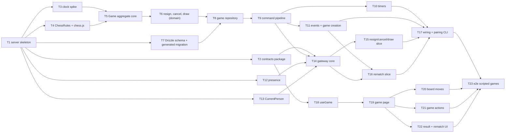

# Epic — game-play

> **PRD:** [PRD.md](../PRD.md) · **Design:** [sad.md](../sad.md) · **Data model:** [data-model.md](../data-model.md) · **Contract:** [events.md](../contracts/events.md) (event-only, no OpenAPI) · **ADRs:** [adr/](../adr/)

## Goal

Two paired players play one live, server-authoritative game of chess in the browser. Every game reaches exactly one correct game end or is aborted, a dropped connection does not cost the game, and a finished pair can go straight into a rematch ([PRD §2](../PRD.md)). This epic is the foundation the boosts feature builds on.

## Scope

- **In:** `game` context on the server (domain, application, infrastructure, presentation); the `shared/events` contracts; a new shared package `@chessboost/contracts` for the Socket.IO types; the Drizzle schema and the generated migration; the temporary `create-pairing` CLI in `match`; the web game route `/game/[id]`, the `useGame` composable and the game components. Surfaces: `backend-service`, `web-frontend` ([sad.md](../sad.md) frontmatter).
- **Out** ([PRD §3](../PRD.md)): boosts, registration and «how players meet», rating, move list, legal-move hints, claim-draw, a disconnect timer, rematch after an abort, chat, spectators, replays, matchmaking, lag compensation.

## Task map

The same DAG as [tasks.json](./tasks.json). Parallel branches after T1: contracts → web (T2 → T18 → …), clock and rules (T3 ∥ T4), schema (T7), presence (T12), identity (T13).

## Tasks

See [tracker.md](./tracker.md) for status. Machine contract: [tasks.json](./tasks.json). 23 tasks, ~15.25 person-days, owner Gleb Bufin.

| # | Task | Layer | Blocked by | DoD (short) |
|---|---|---|---|---|
| T1 | [server skeleton](./t01-server-skeleton.md) | wiring | — | make test (with one smoke test), make arch and make typecheck are green and the server starts with make dev |
| T2 | [contracts package](./t02-shared-contracts-package.md) | wiring | T1 | the package typechecks, a compile-time test covers every events.md event name, error code and GameSnapshot field, and both apps typecheck against it |
| T3 | [clock spike](./t03-clock-spike.md) | domain | T1 | clock unit tests with a fake TimeSource pass for the increment (3+2 gives 3:02), the deadline boundary, the not-yet-running main clock and the 20 s / 60 s abort windows |
| T4 | [ChessRules + chess.js](./t04-chess-rules-port.md) | infra | T1 | adapter tests pass for illegal moves, promotion pieces, mate, stalemate, the en-passant-aware repetition key and the 50-move half-move clock |
| T5 | [Game aggregate core](./t05-game-aggregate-core.md) | domain | T3, T4 | aggregate unit tests pass for every listed AC: turn switch, illegal-move no-op, promotion, mate, the four draw reasons with precedence, bishop colours, timeout win vs draw, abort, and refusal after the end |
| T6 | [resign, cancel, draw (domain)](./t06-game-aggregate-offers.md) | domain | T5 | aggregate unit tests pass for resign, cancel and the draw-offer rules incl. the blocked re-offer and simultaneous offers ending once |
| T7 | [Drizzle schema + generated migration](./t07-drizzle-schema-and-generated-migration.md) | migration | T1 | drizzle-kit generates the live migration from schema.ts, its SQL matches the staged .up.sql (differences listed and resolved), and make migrate applies it on an empty database |
| T8 | [game repository](./t08-drizzle-game-repository.md) | infra | T6, T7 | integration tests on real PostgreSQL pass for round-trip, version conflict, duplicate commandId, one active game per player, release on end, and one open rematch offer per game |
| T9 | [command pipeline](./t09-command-pipeline.md) | app | T8 | application tests pass for strict per-game ordering, idempotent commandId, identical not-found for non-players, and the move-vs-deadline race decided by game time |
| T10 | [timers](./t10-timer-service.md) | app | T9 | tests with fake scheduler and time pass for one Timeout per deadline, exactly one end after a simulated restart, the sweep catching a lost timer, the timeout draw by material, and abort on window expiry |
| T11 | [events + game creation](./t11-integration-events-and-game-creation.md) | app | T9 | tests pass for game creation from MatchCreated with GameStarted after commit, GameNotStarted on an active game, isolated consumer failure, and GameEnded once and never for an abort |
| T12 | [presence](./t12-presence-registry.md) | app | T1 | unit tests pass for multi-tab online counting, a single offline transition, reconnect and per-game isolation |
| T13 | [CurrentPerson](./t13-current-person-adapters.md) | infra | T1 | adapter tests with a local key pair pass for a valid token and reject a bad signature, foreign audience, expired token and unknown email; the dev adapter refuses production |
| T14 | [gateway core](./t14-game-gateway-core.md) | ports | T2, T9, T12, T13 | socket integration tests pass for identical not-found, unauthenticated rejection, room-wide snapshot after a move incl. a second tab, unknown-field rejection, and the offline push |
| T15 | [resign/cancel/draw slice](./t15-resign-cancel-draw-slice.md) | ports | T14 | socket integration tests pass for resign, draw by agreement, the blocked re-offer with retryAfter, simultaneous offers ending once, resign refused in the abort window, and cancel aborting |
| T16 | [rematch slice](./t16-rematch-slice.md) | ports | T11, T14 | socket integration tests pass for one new swapped-colour game on agreement, double press as one offer, refusal while the offerer is offline, close, active-game refusal and no rematch after an abort |
| T17 | [wiring + pairing CLI](./t17-module-wiring-and-pairing-cli.md) | wiring | T10, T11, T15, T16 | make arch is green, the server boots and re-arms timers, create-pairing produces a joinable game, and an overdue game ends exactly once on boot |
| T18 | [useGame](./t18-use-game-composable.md) | ui | T2 | composable tests with a fake socket pass for snapshot state, active-side countdown, no emit while disconnected, pending on ack timeout and re-join on reconnect; web typecheck is green |
| T19 | [game page](./t19-game-page-and-snapshot-mapping.md) | ui | T18 | snapshotToView unit tests and page component tests pass for skeleton, rating-optional players, orientation, offline marker and the abort countdown |
| T20 | [board moves](./t20-board-moves-and-promotion.md) | ui | T19 | component tests pass for rollback on rejection, promotion UCI, closing the picker emitting nothing, and one sound per new half-move |
| T21 | [game actions](./t21-game-actions.md) | ui | T19 | component tests pass for Cancel-only in the abort window, confirmed resign, dialog cancel emitting nothing, each draw state and the blocked message |
| T22 | [result + rematch UI](./t22-result-screen-and-rematch.md) | ui | T19 | component tests pass for every end-reason text, the aborted state, each rematch state, close-before-navigate on New game and the active-game message |
| T23 | [e2e scripted games](./t23-e2e-scripted-games.md) | tests | T17, T20, T21, T22 | the e2e suite is green locally with one named scenario per listed AC, including timeout lateness of at most 1 s with both players offline |

**Serialization lanes** (overlapping `files_hint`):
- `game/domain/game.ts`: T5 → T6.
- `game/presentation/game.gateway.ts`: T14 → T15 → T16.
- `components/game/GameScreen.vue`: T21 → T22.
- Migration lane: T7 only.
T20 runs in parallel with T21 and T22.

## Risks / Hard rules

- **Contexts never import each other.** Only through `shared/events`, enforced by `make arch` (CLAUDE.md, `.claude/rules/game.md`). `domain` imports no npm package and no `@chessboost/contracts`; chess.js stays behind `ChessRules` ([ADR-0005](../adr/0005-chess-js-behind-chess-rules-port.md)).
- **The server is authoritative** ([PRD §6.1](../PRD.md)): clients send intents only; time, legality and the game end are decided on the server; a non-player and a missing game get the same reply (AC-04).
- **Live migrations are generated only by drizzle-kit** (`.claude/rules/migrations.md`). The staged `.up.sql` are the reference to diff against, never copied into the live folder (T7).
- **The clock spike goes first** (T3). Scope-cut decision at the end of implementation week 1 ([PRD §8](../PRD.md)).
- **Exactly one server process** ([sad §7](../sad.md)): the queue, timers, bus and presence are in-process.
- **One contract, one package.** Any change to [events.md](../contracts/events.md) updates `@chessboost/contracts` in the same PR (T2).
- **Manifests and the lockfile are not in `files_hint`.** T1, T2, T4, T7, T13, T14 and T18 add dependencies; when they land in parallel, resolve `package.json` / `pnpm-lock.yaml` conflicts by re-running `pnpm install`.
- **Security review** is required before the first game on the NAS ([PRD §6.1](../PRD.md)). Never read `.env`; only `.env.example` names variables.
- **Open question** ([sad §11](../sad.md)): who tells the players on a storage failure while handling `MatchCreated`. Not solved in T11; `/sdlc:decide-adr game-play` when chosen.
